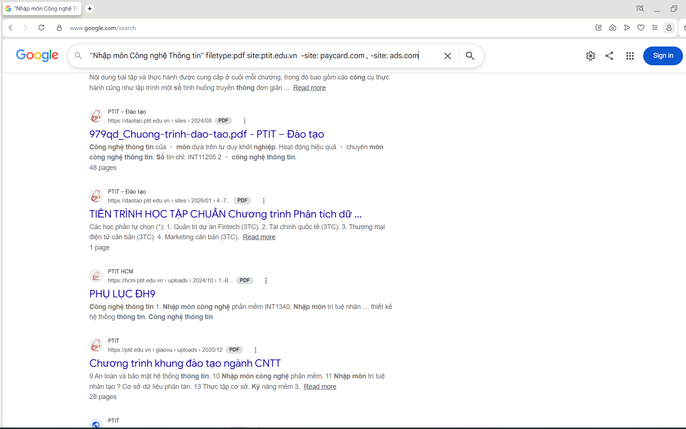

# Bài 1 : Tìm kiếm tài liệu học tập chính thống bằng Google

**Viết một chuỗi truy vấn (Query)**:
"Nhập môn Công nghệ Thông tin" filetype:pdf site:ptit.edu.vn -site: paycard.com , -site: ads.com

**Mô tả tại sao việc dùng toán tử filetype: lại giúp tiết kiệm thời gian hơn so với việc gõ "tải sách..." thông thường:**

Dùng filetype giúp tiết kiệm thời gian vì: kết quả tìm kiếm sẽ ra các web có file pdf, không đưa kết quả  các trang web không có file dạng pdf ,loại bỏ các trang web rác không liên quan giúp người dùng tiết kiệm thời gian sàng lọc thông tin.

**Ảnh chụp màn hình 3 kết quả đầu tiên sau khi áp dụng "Combo toán tử":**

